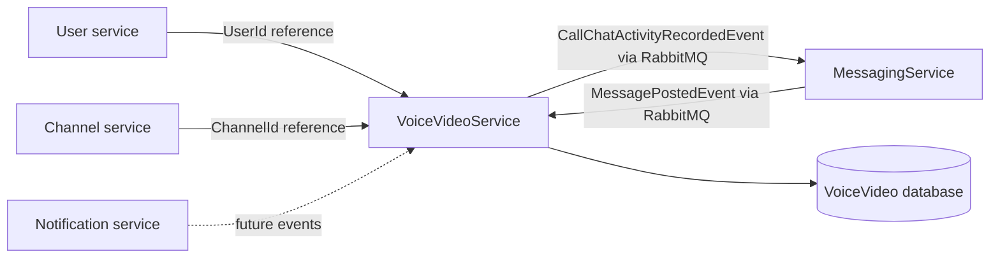
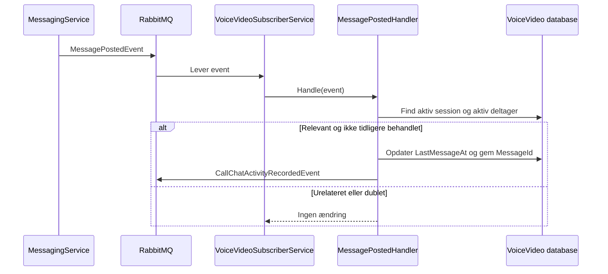

# Bizcord og VoiceVideo bounded context

## Formål og afgrænsning

Bizcord er en Discord-lignende platform opdelt i selvstændige forretningsområder. De overordnede domæner er kommunikation via beskeder, kanaler, brugere, notifikationer og voice/video-opkald. Dette repository implementerer kun **Voice/Video Communication**.

Dokumentet skelner mellem det, der findes i repositoryet nu, og mulige senere udvidelser. Beskrivelser af andre domæner er servicegrænser, ikke implementeringer i dette repository.

## Serviceansvar og dataejerskab

VoiceVideoService ejer:

- `CallSession`-livscyklus, status, start- og sluttidspunkt.
- `CallParticipant`-deltagelse og lyd-, video- og skærmdelingsstatus.
- `LastMessageAt` for en relevant, aktiv opkaldssession.
- Registrering af behandlede `MessagePostedEvent`-id'er for idempotent behandling.

Servicen ejer ikke brugere, kanaler, beskeder eller notifikationer. `UserId` og `ChannelId` er eksterne identifikatorer og er derfor ikke foreign keys til andre microservices' databaser. VoiceVideoService må ikke læse eller skrive deres databaser direkte.

## Faktisk implementering

### REST

Controlleren eksponerer DTO'er fra `Shared.Contracts`; EF Core-entiteter returneres ikke direkte.

| Metode | Endpoint | Resultat |
| --- | --- | --- |
| `GET` | `/api/voicevideo` | Simpel service-status |
| `POST` | `/api/voicevideo/sessions` | Opretter en aktiv session; `201`, `400` eller `409` |
| `GET` | `/api/voicevideo/sessions` | Returnerer alle sessioner inklusive deltagere |
| `GET` | `/api/voicevideo/sessions/{id}` | Returnerer én session eller `404` |
| `PUT` | `/api/voicevideo/sessions/{id}/end` | Afslutter en aktiv session; `204`, `404` eller `409` |
| `DELETE` | `/api/voicevideo/sessions/{id}` | Sletter en session; `204` eller `404` |

Forretningslogikken ligger i `CallSessionService`. Den afviser et tomt `ChannelId` og mere end én aktiv session for samme kanal. EF Core gemmer data i servicens egen SQL Server-database.

### Asynkron kommunikation

`IMessageClient` isolerer applikationen fra EasyNetQ/RabbitMQ. `RabbitMQMessageClient` er transportimplementeringen, og `VoiceVideoSubscriberService` opretter abonnementet.

Et event er relevant, når kanal-id matcher en aktiv session, og forfatteren er en deltager uden `LeftAt`. `MessageId` er primary key i behandlingstabellen, så en genlevering ignoreres.

### Deployment

Docker Compose starter RabbitMQ, SQL Server og API'en. API'en venter på begge healthchecks. Konfiguration leveres via miljøvariabler, mens `.env` er ignoreret. Ved opstart kalder API'en `EnsureCreatedAsync`, så en ny database får det aktuelle skema.

## Arkitekturbeslutninger

1. **Database pr. service.** VoiceVideo-data er isoleret, og andre domæner refereres kun med id'er.
2. **DTO'er ved API-grænsen.** Domæne-/persistence-entiteter er ikke eksterne kontrakter.
3. **Broker bag interface.** EasyNetQ kan udskiftes uden at ændre handlers eller forretningslogik.
4. **UTC-tidspunkter.** Alle servergenererede tidspunkter bruger `DateTime.UtcNow`.
5. **Idempotent message-handler.** Behandlede `MessageId` gemmes sammen med sessionopdateringen.
6. **Enkel opstartsinitialisering.** `EnsureCreatedAsync` er valgt til opgaven; migrations er et senere driftstiltag.

## Planlagt eller fremtidigt arbejde

Følgende er ikke implementeret og må ikke læses som nuværende funktionalitet:

- EF Core migrations og en kontrolleret migrationspipeline.
- Transactional Outbox, så databaseændring og publicering får stærkere leveringsgarantier.
- Databasehåndhævet unikhed for én aktiv session pr. kanal under samtidige requests.
- REST- eller eventoperationer til join/leave og ændring af mute/video/screenshare.
- Eksplicit sammenknytning af en besked med `CallSessionId`; den nuværende regel bruger kanal og aktiv deltager.
- Events til notifikationer, analytics eller arkivering.
